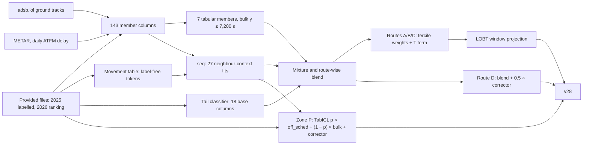

# Model design: departure taxi-out time at ten European airports

**PRC Data Challenge 2026** · Team **understanding-accordion**

Author: Alexander Beiser (TU Wien), team understanding-accordion.

This document explains what the submitted model is, why each part has its shape, and what evidence supports it. It
describes **v28**, our best file on the public leaderboard (RMSE 235.3996, rank 21 of 232 on 2026-10-06), which is
assembled from stored model outputs by `python assemble.py --arm-u UT --lobt-window --out v28`.
[PIPELINE.md](PIPELINE.md) says which script writes each stored component, [RESULTS.md](RESULTS.md) lists every
upload with its offline expectation and live score, [VALIDATION.md](VALIDATION.md) gives the protocol and the full
account of leaderboard use, and [REPRODUCE.md](REPRODUCE.md) explains how to rebuild v28.

**Conventions.** Times are in seconds; Δ is a change in all-flight RMSE, negative is better. A 2025 number is
out-of-fold from 12-fold leave-one-month-out (LOMO) cross-validation on the labelled 2025 files unless stated
otherwise. *Held-out* means the 8 months never used to fit blend weights (1, 2, 4, 5, 7, 8, 10, 11); *scored* means
January + July 2025, the calendar months of the 2026 ranking set. Brackets are paired-bootstrap 95% intervals
(airport × day blocks from v18, 2026-09-26, on; rows before). **[label-free]** marks a statement about 2026 computed
only from non-label fields of the ranking file and from external data; nothing here is derived from 2026 departure
labels or leaderboard feedback, except our own scores, which are marked *live*. v1–v28 are our uploads in order.

**Contents.** [1 Problem framing](#1-problem-framing) · [2 Error anatomy of 2025](#2-error-anatomy-of-2025) ·
[3 Overview](#3-overview-of-the-shipped-model) · [4 The mixture](#4-the-mixture-tail-classifier--tail-anchor--bulk) ·
[5 Members and feature families](#5-members-and-feature-families) ·
[6 The neighbour-context model](#6-the-neighbour-context-sequence-model-seq) · [7 The blend](#7-the-blend) ·
[8 Zone P](#8-zone-p-a-foundation-model-tail-probability) · [9 Route D](#9-route-d-and-its-corrector) ·
[10 The LOBT window](#10-the-lobt-window-an-artefact-of-how-the-dataset-was-built) ·
[11 Information use](#11-information-use-statement) · [12 Limits](#12-limits) ·
[13 Data-quality notes](#13-data-quality-notes-for-the-organisers) ·
[14 How this was built](#14-how-this-was-built-and-credits)

---

## 1. Problem framing

### 1.1 The label is a clock difference

On all 2,085,047 departures of the 2025 training files, `TAXITIME_SEC_mvt = MVT_TIME_UTC_mvt − BLOCK_TIME_UTC_mvt`
holds exactly. In the ranking file the take-off time `MVT` is given and `BLOCK` is blank, so the task is to predict
*when the airport recorded the off-block*, counting back from a known take-off.

The row carries several other clocks for the same event: the airport's schedule `SCHED`, and from the Network
Manager (NM) flight data `IOBT` (initial, from the flight plan), `EOBT_1` (estimated, updated by later messages),
`LOBT` (the last value NM calculated) and `AOBT_3` (NM's actual off-block). According to the organisers these come
from operations without post-ops adjustment. Most of what the model knows is an offset from take-off back to one of
these clocks (`off_aobt3 = MVT − AOBT_3`, `off_sched = MVT − SCHED`, `off_eobt`, `off_lobt`), plus reasons why the
recorded `BLOCK` sits where it does relative to them.

`AOBT_3` is the strongest of them because it records the same physical event in a different system. In 2025,
`BLOCK − AOBT_3` has median +51 s, interquartile range [−122, +183] s and standard deviation 385 s; only 21% of rows
agree within ±60 s, and the bias depends on the airport (LTFM +237 s, EHAM +152 s, LIRF −213 s). `AOBT_3` is
present on 98.92% of 2025 and 98.47% of 2026 departures [label-free].

### 1.2 Four routes from the NM record, and zone P

The routes are defined by the NM proxy `MVT − AOBT_3`, from provided fields only, so the assignment is identical in
training and ranking.

| group | definition | 2025 departures | 2025 rows with y > 7,200 s | 2026 departures [label-free] |
|---|---|---:|---:|---:|
| A / B / C | `MVT − AOBT_3` in (0, 7,200] / > 7,200 / ≤ 0 | 2,061,500 / 19 / 1,058 | 103 (0.005%) | 339,551 |
| D | no `AOBT_3`, not in P | 17,526 | 31 (0.18%) | 3,570 |
| **P** | no `AOBT_3` and `off_sched` > 7,200 | 4,944 | 450 (9.1%) | 1,720 |

When `AOBT_3` is missing, the whole NM block (`LOBT`, `EOBT_1`, `IOBT`, operator, market segment, arrival-side
clocks) is missing with it in 100.00% of 2025 rows; a route-D flight is described only by its schedule, stand,
runway, aircraft type and the movements around it. Of the 584 departures with y > 7,200 s in 2025, 481 have no NM
record and 450 are in zone P, 413 of them at Rome (65.9% of Rome's 627 zone-P rows). The other nine airports hold 37
zone-P tails among 4,317 zone-P rows (LTFM 19 of 265, EGLL 11 of 513, LFPG 5 of 987, LSZH 2 of 233, the other five
0 of 2,319). In zone P's tail rows the label equals `off_sched` to a median of 3 s: the recorder wrote the scheduled
time as the off-block of a flight that left hours late. We call this *stamping at the schedule*.

In 2026 zone P holds 0.50% of departures against 0.41% in January + July 2025, and January has 1,041 zone-P rows
against 318 in January 2025, mostly at EHAM during a winter disruption on 2–7 January when up to 40% of EHAM
departures had no NM record [label-free].

### 1.3 What RMSE on this target rewards

The squared error is concentrated: in 2025 out-of-fold predictions (v21 structure) the worst 0.1% of rows carry 50%
of the 12-month squared error and the worst 1% carry 66%; on January + July 2025, ten rows carry 42% (v17
structure). An absolute RMSE on January + July 2025 therefore has a bootstrap standard deviation of about 47 s while
the models we compare differ by fractions of a second, so every comparison is paired (both models on the same
resampled rows), which cuts the standard deviation of a difference by 2.7×; pooling all 12 months cuts it by
another 2.2–2.5× ([VALIDATION.md](VALIDATION.md)).

No single L2 regressor serves both halves of the distribution. Trimming the training target at 2 h improved the bulk
RMSE on January and July 2025 by 38 s and worsened the 149 tail rows by 6,748 s RMSE; on the leaderboard the trimmed
model lost by 36 s (v1 543.67 vs v2 507.55). The explicit mixture of §4 resolves this.

---

## 2. Error anatomy of 2025

### 2.1 Where the squared error sits

The table splits v24's out-of-fold errors by a post-hoc label taxonomy that serves diagnosis only and is never a
feature (`experiments/drivers_0926/d02_decompose.py`). v24 is the last structure before the changes of §7.2, §7.3
and §10. v24 out-of-fold RMSE: 229.58 (12 months), 235.44 (held-out), 292.21 (scored); the v28 structure scores
234.37 held-out and 290.68 scored (the window part in-sample).

| class | rule (y = label, so = `off_sched`) | rows | RMSE in class | share of SSE, 12 months | share, Jan + Jul |
|---|---|---:|---:|---:|---:|
| ordinary ≤ 30 min | none of the rules below, y ≤ 1,800 | 1,933,685 | 136 | 32.4% | 23.4% |
| day-scale artefact | y > 12 h and \|y − so\| > 600 | 15 | 45,193 | 27.9% | 41.1% (7 rows) |
| bulk stamped at the schedule | y ≤ 2 h, \|y − so\| ≤ 120, so > 1,200 | 87,852 | 385 | 11.8% | 8.7% |
| ordinary 30–60 min | | 56,457 | 451 | 10.5% | 9.2% |
| zone P, real pushback | zone P and y ≤ 2 h | 4,494 | 1,259 | 6.5% | 8.3% |
| ordinary 1–2 h | | 1,975 | 1,623 | 4.7% | 3.8% |
| other > 2 h | y > 2 h, no clock signature | 109 | 5,953 | 3.5% | 3.0% |
| > 2 h stamped at the schedule | y > 2 h, \|y − so\| ≤ 120 | 438 | 2,363 | 2.2% | 1.9% |
| Rome, `BLOCK` 1–2 h before `SCHED` | LIRF, y > 2 h, 3,600 ≤ y − so ≤ 7,800 | 22 | 4,677 | 0.4% | 0.6% |

**Day-scale artefacts** are 15 departures whose recorded `BLOCK` lies about a day before the real off-block (12 Rome
zone-P rows, 2 Paris and 1 Zurich route-D rows). They carry 27.9% of the 12-month error and 41.1% of January + July;
without them v24 scores 194.97 (12 months) and 224.25 (January + July). We found no pre-take-off signal that
separates them reliably: all lack the NM record, and the best candidate (take-off on a later local date than
scheduled, with a large delay; 12 of 20 such Rome rows in 2025 were day-shifted) failed its interval rule at −2.55
[−8.4, +2.1].

**Recording artefacts** (stamping in the bulk and the tail, zone-P real pushbacks, Rome's early mode) are about a
fifth of the error (21.0% in the v17 analysis), a property of who records the off-block rather than of the aircraft.
**Ordinary flights** are 41% of the error above a label-noise floor: where adsb.lol sees the pushback at EDDF, EDDM,
EHAM and LSZH the model's RMSE on ordinary rows is 66 s, and the recorded label itself scatters around the ADS-B
pushback with a robust spread (1.48 × MAD) of 26 s at EHAM, 39–59 s at LSZH, EDDM and EDDF, and 119 s at LIRF.

### 2.2 Where the 2026 error is expected [label-free]

Method: **2025 cell MSE × 2026 cell counts, label-free.** Cells are airport × route × adsb.lol status (off-block
seen / ground points only / no ground) × `off_sched` band; the per-cell MSE comes from v24's 12-month out-of-fold
predictions without the 15 day-scale rows, the counts from the 2026 ranking file. The expected RMSE of the modelled
part is 209.5. This says nothing about how many artefact rows 2026 contains, and we do not infer that from our score.

| airport | expected share of 2026 SSE |
|---|---:|
| LIRF | 42.0% |
| LTFM | 18.3% |
| LFPG | 13.6% |
| EGLL | 7.3% |
| LEBL / LEMD | 4.4% / 4.3% |
| EDDF / LSZH / EHAM / EDDM | 3.2% / 2.8% / 2.7% / 1.5% |

| largest cells (2026 rows) | expected share of 2026 SSE |
|---|---:|
| LTFM A/B/C, no ground data (46,839) | 15.9% |
| LIRF A/B/C, no ground data (16,956) | 15.0% |
| LIRF zone P, no ground data (146) | 9.9% |
| LIRF route D, no ground data (173) | 7.4% |
| LFPG A/B/C, no ground data (20,824) | 7.2% |
| LFPG A/B/C, ground points only (18,255) | 5.0% |

These six cells hold 60% of the expected error, at the three airports where no open data source sees the stands
(§12).

### 2.3 What the anatomy implied for the design

The day-scale artefacts are neither modelled nor tuned to. Stamping calls for an explicit mixture with `off_sched` as
the tail anchor and a classifier for its probability (§4, §8). Ordinary flights call for observing the physical
pushback (adsb.lol, §5.3) and the surroundings: runway queue, stand turnover and neighbouring movements (§5.1, §6).
Because the expected 2026 error concentrates where no open source sees the stand, information that needs no ADS-B
(NM clocks, turnover, the neighbour-context model) is worth the most there.

---

## 3. Overview of the shipped model



One closed formula per row group ([../assemble.py](../assemble.py)):

```
routes A/B/C (339,551 rows):  q = window( rint(clip( blend_U[bin] + λ[bin] · mean_s(1 − p_s) · (seq10 − seqnc10) )) )
route D outside P (3,570):    q = rint(clip( blend_D + 0.5 · corr ))
zone P (1,720):               q = rint(clip( p · off_sched + (1 − p) · pb + corr ))

blend_W = mean over 5 classifier seeds s of  clip( W_b · p_s · e + (1 − p_s) · Σ_f w_f · bulk_f + w_routed · routed )
```

`p_s` and `e` are the tail classifier and anchor (§4), the weights `w_f` come from §7, `bin`, `λ` and
`seq10 − seqnc10` from §7.2–7.3, `p` and `pb` from §8, `corr` from §9 and `window` from §10. All final models are
fitted on all twelve months of 2025, members with 3 seeds each. No model is fitted on 2026 rows; 2026 rows enter only
as inputs at prediction time (as other rows' fields in the features, and as seq contexts). The fold campaigns and
final fits took an estimated 150 GPU-hours (8 × L40S) and 40 CPU-hours on a university cluster (`<cluster>`);
evaluation and assembly run on a laptop.

---

## 4. The mixture: tail classifier × tail anchor + bulk

`E[y | x] = P(T | x) · E[y | T, x] + (1 − P(T | x)) · E[y | ¬T, x]`, with `T = {y > 7,200 s}`.

Each member's bulk regressor is trained on the 2,084,463 departures with y ≤ 7,200 s. The tail anchor `e` is
`off_sched` when `off_sched` > 7,200 s, because a flight stamped at the schedule has y = `off_sched`, and otherwise the
mean 2025 tail label (14,893 s). `P(T | x)` is one binary LightGBM (63 leaves, learning rate 0.05, 300 rounds) on
all rows but only 18 base columns (airport, runway, pier, stand, type, operator, market segment, wake category, the
clock offsets, hour, weekday, missing flags); production averages the clipped mixture over 5 classifier seeds.

With the same features, replacing a single regressor by the mixture took the live score from 507.55 (v2) to 352.27
(v3), −155 s; offline, on the January + July 2025 holdout, the paired gain was −66.1 ± 28.9 [−131.3, −16.8], and the
classifier was calibrated there (mean p 0.000427 against an observed rate of 0.000433). The classifier is kept lean on
purpose: adding the congestion columns left the 10-seed RMSE unchanged (< 0.5 s) but tripled its seed-to-seed
standard deviation (0.91–0.97 s → 2.81–2.88 s). 435 positives among 1.74 million training rows do not support more
inputs.

Where the mixture acts follows from one line of algebra. For a group with tail rate q, anchor a and bulk value b,
predicting b costs MSE `q(a − b)²`, and a perfectly calibrated probability lowers it to `q(1 − q)(a − b)²`, a 0.3%
reduction at q = 0.003. Outside zone P, where the classifier's p is about 1e-4, the tail branch is inert; only
*discrimination* pays, and the only population where q is large is zone P (9.1%), above all Rome (65.9%). That is
why zone P has its own classifier (§8).

---

## 5. Members and feature families

### 5.1 Feature families

All seven tabular members, and the target branch of seq, see the same 143 columns per departure
([../cluster/w2_features.py](../cluster/w2_features.py), [../cluster/w2_extra.py](../cluster/w2_extra.py)). Every
column is computable from fields present for departures in the ranking file; departure `BLOCK` and `TAXITIME` are
dropped and asserted absent before any builder runs, and event-based features are built month by month so no ranking
feature crosses between January and July. The evidence column gives the measured effect when the family was added;
each entry names its protocol.

| family (columns) | domain reason | evidence |
|---|---|---|
| **Base** (18): airport, runway, pier (leading block of the stand id), stand, aircraft type, operator, market segment, wake category; `off_aobt3`, `off_sched`, `off_eobt`, `off_lobt`, hour, weekday, missing flags | Taxi-out is take-off minus an off-block clock, and `AOBT_3` records that off-block in a separate system. Stand, pier and runway fix the taxi distance (pier means alone differ by up to 999 s at EHAM); airline-to-terminal assignment is already in the stand. | January + July 2025 holdout, capped at 2 h: LightGBM on 13 base columns 257.6 vs 364.5 for the best group mean (airport × runway × stand) |
| **NM flight-plan clocks** (8): `AOBT_3 − SCHED`, `MVT − IOBT`, `LOBT − IOBT`, `EOBT − LOBT`, `AOBT_3 − EOBT`, `AOBT_3 − LOBT`, `EOBT − SCHED`, `IOBT − SCHED` | IOBT → EOBT → LOBT → AOBT_3 records how the off-block plan moved. The differences separate an announced delay (off-block re-filed, normal taxi) from an unannounced one (actual well after the last plan), and the recorded `BLOCK` relates to each clock differently at each airport. | With stamping (next row): residual booster on a frozen blend, −2.96 [−3.35, −2.60] over 12 months, 12/12 months (row bootstrap) |
| **Previous-arrival stamping** (3): was the last arrival at our stand in-blocked exactly at its scheduled time; in-block − SIBT; landing − SIBT | A recorder that writes scheduled times for arrivals at a stand tends to do so for its departures too (Rome, §13). | included above |
| **Stand turnover** (12): backward (previous occupant's in-block vs our schedule) and look-ahead (next occupant's in-block vs our take-off and schedule, same type or operator; gaps to neighbouring departures), each capped at 48 h | A stand holds one aircraft: the next arrival's in-block normally follows our off-block and bounds it from above, and a late previous occupant compresses our turnaround. | on top of the clocks: backward −0.64 [−0.73, −0.55]; look-ahead on top of backward −2.13 [−2.37, −1.90]; 12/12 months each |
| **Congestion** (26): trailing 15/30/60-min counts of take-offs, landings, in-blocks and NM pushbacks at airport and runway level; take-offs on our runway between our `AOBT_3` and our take-off; aircraft taxiing out at our pushback; gap to the previous take-off | Taxi-out = unimpeded taxi + queueing at the runway; throughput and queue length drive the second part. | −4.27 ± 1.78 [−7.7, −0.8], 12-fold; every month 4–6 s better except July (+1.3) |
| **METAR and ATFM** (28): latest METAR at or before take-off (temperature, dew point, wind, gust, visibility, ceiling, snow / freezing / rain / fog / thunderstorm flags, de-icing-likely, runway-relative wind); EUROCONTROL daily arrival ATFM delay by cause | Snow and frost mean de-icing, at several airports after off-block on remote pads; low visibility increases spacing; an arrival-regulated day is a day of reduced airport capacity. | in the bulk regressor, 10-seed averages: −1.80 ± 0.11 [−2.0, −1.6]; harmful in the tail classifier, so kept out of it |
| **Wake sequence and backlog** (12): own and previous wake category, required departure separation (ICAO Doc 4444), actual gap to the previous take-off on our runway, heavies among the previous 10, pair code; overdue departures at our scheduled time (5 counts, each flight counted for at most 4 h) | Wake separation spaces departures (our 2025 data give median gaps under 600 s of 109 / 143 / 181 s for a medium behind a medium / heavy / super); the backlog at our scheduled time is the queue we will join. | on top of the adsb.lol members: held-out −1.74 [−2.01, −1.45], scored −1.53 [−2.07, −1.00], January −0.85, July −2.24, 12/12 months; largest at LTFM (−5.9) |
| **adsb.lol ground movement** (35): own-flight off-block candidates (first point, first movement, end of rest, pushback, best estimate and source), rest / dwell / stop / hold times, path length, taxi speed, coverage quality and airport-day coverage, distance of the first point from the stand's typical pushback position | The only direct observation of the physical pushback; what remains once it is seen is the label-noise floor of §2.1. | held-out −17.74 [−19.64, −15.59], scored −15.29 [−18.69, −11.98], January −13.76, July −17.46, 12/12 months (§5.3) |

The wake-sequence idea was prompted by a question the organisers asked on the challenge Discord and by a
participant's reply there (§6.1); the overdue-queue backlog idea comes from a public competitor repository (credits in
the README). The implementation and the measurements are ours.

### 5.2 Learners

Each tabular member is fitted with 3 seeds and averaged. Weights come from §7; on routes A/B/C they depend on the
bin of §7.2 (bin 0: the seq fits agree; bin 2: they disagree).

| member | learner | route D weight | A/B/C weights, bins 0 / 1 / 2 |
|---|---|---:|---|
| `perapt` | ten per-airport LightGBMs (255 leaves, 700 rounds) | .194 | .383 / .223 / 0 |
| `routed` | route-specific LightGBM ([../prc/models/routed.py](../prc/models/routed.py)): route A regresses `y − (MVT − AOBT_3)` and adds the proxy back, route C regresses y directly, route D has its own bulk, classifier and anchor | .509 | 0 / .014 / .199 |
| `xgboost` | XGBoost hist, depth 10, 1,200 trees, learning rate 0.05 | 0 | .128 / .108 / .082 |
| `w3` | piecewise-linear encoded numerics with missing indicators, residual MLP (width 384, 3 blocks), two heads (EHAM / EGLL / LFPG / EDDF and the rest) ([../prc/models/w3_net.py](../prc/models/w3_net.py)) | .027 | .092 / .006 / .120 |
| `seq` | neighbour-context set model, mean of 27 fits (§6) | .280 | .398 / .648 / .605 |
| `mix`, `nn`, `lintree` | LightGBM (511 leaves); entity-embedding MLP 512-256-128; LightGBM with linear leaves | 0 | 0 |

`mix`, `nn` and `lintree` have zero weight in v28; the version of `mix` without adsb.lol is still half of zone P's
real-taxi branch (§8), and `nn` was the main network member until seq replaced it in v19. `routed` exists because a
bulk regressor trained on y ≤ 7,200 s cannot emit a long taxi time; routing by the NM proxy gives each population a
consistently defined target (an earlier single model whose residual target changed meaning between rows with and
without `AOBT_3` lost in every month).

### 5.3 adsb.lol: the flight's own ground track

We streamed the adsb.lol `globe_history` daily releases (ODbL 1.0) for 2025 and January/July 2026: 429 days, 1.331
TB, not stored. Stage 1 keeps points within 12 km and 6,000 ft of each airport, one day per job; stage 2 extracts per
aircraft the first ground point, first movement, end of rest at the stand, pushback, the first point at ≥ 40 kt and
the take-off, with a per-airport-hour correction because ADS-B altitude is pressure altitude (it raised the January
2026 match rate from 71% to 84%). Events are matched to departures by callsign, flight number, then type and time
(94–99% on five July 2025 test days, except LTFM at 0.2%), and turned into the 35 columns of §5.1
([../experiments/adsb/adsb_build_features.py](../experiments/adsb/adsb_build_features.py)). The stand reference
position is the median 2025 pushback position per stand with at least 3 pushbacks; positions only, no labels.

Where the pushback is seen, the ADS-B off-block lies within a median of 18–61 s of `BLOCK` at EHAM, LSZH, EDDF and
LEBL, against 126–145 s for `AOBT_3`, and is the closer of the two on 80.5% of matched flights (five July 2025 days).
An off-block estimate exists for 19.4% of 2025 and 25.6% of 2026 departures [label-free], with large shifts: EGLL in
July from 2% to 67%, EDDM in July from 23% to 68%, LFPG and LTFM about 0 in both years, and LIRF in July from ground
points on 96% of departures to 1.5% [label-free].

Inside all members the 12-month effect per airport was EDDF −58.2, EDDM −57.0, EHAM −56.7, LEBL −45.8, LEMD −32.8,
LSZH −28.0, EGLL −18.4, LIRF −5.6, LFPG −1.2 and LTFM +2.2, with 2% of the gain in the 100 most-improved rows;
*live*, v17 added these columns together with the wake/backlog columns, −23.53. The coverage columns (*where* a
flight was heard) drift most between 2025 and 2026, but dropping them costs about 3 s of 2025 bulk RMSE and does not
shift 2026 predictions systematically where coverage changed most [label-free], so we kept them. Back-calculating an
off-block from where an aircraft reappears after a coverage gap raised coverage from 19.9% to 55.0% on 14 test days
but added nothing (−0.03 [−0.31, +0.24]). §11.2 discusses the use of a flight's own post-pushback track.

### 5.4 Information inside the members, not on top of them

| information | as a correction on a frozen blend | inside the members |
|---|---|---|
| NM clocks, stamping, turnover | v11: offline −4.82 (12 months), *live* −2.64 | v14: offline −1.47 held-out / −2.30 scored against the blend plus that correction, *live* −7.58 (v14 also changed 1,539 non-Rome zone-P probabilities [label-free count], estimated at −0.1 to −0.2) |
| adsb.lol | residual correction on 6 labelled days: −10.5 | held-out −17.74 (§5.3) |
| neighbour context | seq fitted to the residual of v17: +3.89 (worse) | 8th member: scored −1.51, *live* −1.60 (§6.4) |

The pattern held throughout: information inside the members delivered as much live as offline or more (v14 ×3, v15
×1.5, v17 ×1.4), while residual layers and pure diversity delivered about half (v11 ×0.50 against its January + July
estimate, ×0.55 against the 12-month one; the second network architecture W3 in v16 ×0.55). Every later information
source was therefore added as member columns or as a member.

---

## 6. The neighbour-context sequence model (seq)

### 6.1 The question it answers

In September 2026 (recorded by us on 2026-09-25) the organisers asked on the challenge Discord whether any team takes the *sequence of aircraft types*
into account (departures of similar wake category sequenced together, or waiting for the air to settle behind a
heavier aircraft), noting that they saw much feature engineering "by the book" and little domain-specific "magic".
Two parts of our model respond. The wake-sequence columns of §5.1 encode the sequence by hand. seq generalises it:
instead of fixed summaries over the neighbours it reads the neighbouring movements themselves and learns which of
their properties matter for the departure being predicted.

Hand-built neighbour summaries had run out. A current-state booster (median NM taxi of recent departures, arrival
taxi-in, share without an NM record) made the model worse on all rows (+0.8 s); adsb.lol surface congestion gave
+0.09 [−0.02, +0.20]; other departures' "remote rest" (de-icing) share gave −0.11, carried by its 100 most-improved
rows.

### 6.2 Design ([../prc/models/seq_net.py](../prc/models/seq_net.py))

**Context.** For each departure: the K = 64 movements nearest in take-off or landing time at the same airport within
±90 min, departures and arrivals, never crossing an (airport, UTC month) group. The ranking file holds only January
and July 2026, so a context that crossed a month boundary in training could not be reproduced at prediction time; in
the final fits the groups also include the year, so a 2026 context contains only 2026 movements of the same month.
The slots fill to a mean of 63.7; the median context reaches ±22–31 min at the six busiest airports and ±31–50 min at
EDDM, LEBL, LIRF and LSZH.

**Tokens** (71 numeric fields plus wake and runway embeddings, all label-free): the neighbour's take-off or landing,
`AOBT_3`, `SCHED`, `EOBT_1` and, for arrivals, in-block, each relative to our take-off, our `AOBT_3` and our `SCHED`;
its phase and whether it shares our runway, stand or pier; its own clocks (`MVT − AOBT_3`, `MVT − SCHED`,
`MVT − EOBT_1`); for arrivals, taxi-in and in-block delay, which are provided in the 2026 ranking file; for
departures, their adsb.lol timings. All fields are deterministic transforms (signed logs of seconds), so training and
ranking contexts come from the same code with no fitted state except the categorical vocabularies, taken from the
training file.

**Leakage guard.** `movement_table` blanks `BLOCK_TIME` on every departure row before any other code reads it, and
blanks arrivals' origin-side clocks; `assert_label_free` checks again that no departure carries an in-block time,
taxi-in or in-block delay. A separate check over training and ranking together (2,429,888 departures) found 0
neighbours outside the target's airport-month, 0 beyond ±90 min, 0 self-neighbours and 0 departures with an
in-block time ([../experiments/seq/s03_context_checks.py](../experiments/seq/s03_context_checks.py)).

**Network.** The target branch takes the departure's own 143 member columns (robust-scaled, clipped at ±8, NaN set to
0 plus a missing flag) and embeddings through 512 → 256 (GELU, dropout 0.1). The tokens are projected to d = 64. A
CLS token projected from the target branch is prepended, and a 2-layer pre-norm transformer encoder (4 heads,
feed-forward 128) runs over [CLS; tokens], so attention is conditioned on the departure being predicted. The head
reads [target 256, CLS 64] → 128 → 1; about 0.5 M parameters. The target is standardised taxi seconds on the bulk rows
(y ≤ 7,200 s) with MSE, AdamW + OneCycle, batch 4,096, bf16 on GPU (one fold takes about 4 min on one L40S at 10
epochs); the tail comes from the shared production classifier as for every member.

**The twin `seqnc`** is the same network on the same data with the context branch removed: a tabular MLP on the 143
columns (0.41 M parameters). It is the ablation against which the context is judged, and it also enters production
through §7.3.

### 6.3 What the context contributes: the ablation against the twin

Before any cluster run, a laptop subset (3 training months, three airports, one held-out month) measured seq minus
seqnc:

| fold | all | per airport |
|---|---|---|
| July, LTFM / LFPG / EHAM (2 seeds) | −9.42 [−11.92, −7.04] | LTFM −16.14 [−21.02, −12.46]; LFPG −6.60 [−8.83, −4.29]; EHAM −0.27 [−0.94, +0.34] |
| January, same airports (1 seed) | −2.96 [−5.18, −0.74] | LTFM −5.79 [−8.96, −3.52] |
| July, LIRF / EGLL / EDDF (1 seed) | +2.56 [−1.11, +6.93] | EGLL −2.86 [−5.52, −0.27]; EDDF +0.10; LIRF +8.47 [−0.26, +17.38] |

In the July fold the gain sat on departures *without* their own ADS-B off-block (−10.64), not on those with one
(−0.03). At full scale (12 LOMO folds × 3 seeds, all ten airports) the context effect on bulk rows was −5.68
[−6.53, −4.82]: LTFM −17.0, LFPG −6.3, LIRF −4.7, EGLL −4.0. With ten times the training data, Rome's sign reversed.

What the context is *not*: removing same-stand neighbours (0.4 of 64 slots) keeps 99% of the effect (+0.07 [−0.93,
+1.31]), so it is not the stand look-ahead; seven label-free medians over the same neighbours explain −1.07 s of
v17's residual in a cross-fitted linear fit against −4.52 for the context difference, and each correlates
|r| ≤ 0.04 with it, so it is not a hand-built aggregate. Half of it needs neighbours later in the file: past-only
contexts (31.8 slots on average) keep 56% of the effect (LTFM 58%, LFPG 51%).

The context helps where nobody observes the aircraft on the ground (LTFM, LFPG, flights without their own off-block)
and adds nothing where adsb.lol sees the pushback (EHAM, EDDF). Our reading is that seq reconstructs the queue state
from what the other movements' clocks imply: how long the departures around us took between their NM off-block and
take-off, how the arrivals' taxi-in behaved, how the runway sequence was spaced. This is a hypothesis consistent with
the ablations, not a demonstrated mechanism.

### 6.4 seq in the blend

As the 8th member (v18 structure, 3 seq × 3 member seeds) seq gave held-out −2.11 [−2.97, −1.53], scored −1.51
[−2.41, −0.89], January −1.00 [−2.09, −0.41], July −2.01 [−3.12, −0.98], 12/12 months, each seed alone −1.57 / −1.72
/ −1.87, with 21% of the gain in the 100 most-improved rows. NNLS gave it weight 0.40 on A/B/C and 0.39 on route D,
and the entity-embedding network fell to 0; seq was the best single member (held-out RMSE outside P 223.9 vs 226.7
for `w3`). A pre-registered second arm that kept Rome on the 7-member blend, motivated by the subset result, passed
(−1.70) but was worse, and the tie-break shipped the primary arm. *Live*, v19: −1.60. In zone P's real-taxi branch,
seq's bulk replaced the no-ADS-B network (held-out −0.65 [−1.29, −0.22], scored −0.73 [−1.28, −0.35]; on zone P's
real pushbacks seq errs 590 s against 766 s); *live*, v20: −3.02.

Training longer helped up to 30 epochs (each step pre-registered, 3 seeds against 3): 10 → 15 epochs −0.65
held-out (*live* v21 −0.26), 15 → 20 −0.26 (v22 −0.32), 20 → 30 −0.60 (v23 −0.49); eight further settings (up to 80
epochs, width 128, 3 layers, learning rate 3e-3) each failed against 30 epochs. We then wrote a rule for the mean of
all 27 fits of that grid (9 settings × 3 seeds, none selected) before evaluating it: held-out −0.61 [−0.86, −0.32],
scored −0.65 [−0.98, −0.40], every airport better; *live*, v24 −0.44. The pool was defined after seeing the grid, so
it is post hoc even though its rule preceded its run; a 54-fit pool failed (−0.105 [−0.238, +0.011]). seq gains the
most of all members from averaging: single 30-epoch seeds score 225.45–225.73 held-out, their 3-seed mean 221.90
and the 27-fit pool 220.24.

---

## 7. The blend

### 7.1 Route-wise NNLS and the production tail branch

Weights are non-negative least squares without intercept, per route group, fitted on the screening months 3, 6, 9 and
12 outside zone P and judged on the other 8 months and on January + July. Route D and A/B/C get separate weights
because their errors differ in kind: route D has no NM clock, and there `routed`'s own tail handling dominates
(.509). In CV each member's mixture uses its own per-fold tail classifier, while production shares the 5-seed
production classifier across members and averages the blend over its seeds, so the weights are fitted on slightly
different objects than they are applied to; on A/B/C, where p ≈ 1e-4, the difference is small.

Linear blending is close to the limit of what the members carry: each member's residual difference correlates at most
|0.064| with the blend residual. Per-airport weights (tried repeatedly; the last January → July cross-fit +0.375,
LIRF +3.05), route × own-coverage weights (scored +0.082), binned recalibration by prediction (+0.267 / +0.129), a
member-disagreement-binned correction (+0.154) and adding the seven pre-adsb.lol members (weights about 0) all failed.

### 7.2 Disagreement-tercile weights on A/B/C (U)

`s_i` is the standard deviation of the 27 seq-pool predictions for row i (out-of-fold fits in 2025, final fits in
2026): how unstable the sequence model is for that flight. Rows are binned by terciles with fixed 2025 cut points
(13.86 s and 25.38 s, screening months outside P), never re-estimated on 2026; the 2026 bin shares are .283 / .342 /
.375 [label-free] against .324 / .329 / .346 in 2025. Each bin gets its own NNLS weights over the 8 members (§5.2):
where the seq fits agree (bin 0) the per-airport trees carry 38%, where they disagree (bin 2) weight moves to the seq
pool mean and to `routed`, which anchors on the NM proxy
([../experiments/seq/arm_u_eval.py](../experiments/seq/arm_u_eval.py)).

The design was found post hoc among about 18 variants screened on 2026-10-01; its gates were frozen and committed
before the evaluation run (9d0dd0b). Result: held-out −0.199 [−0.265, −0.147], scored −0.255 [−0.425, −0.145],
January −0.100, July −0.408; per seed −0.20 / −0.20 / −0.19; −0.081 without the 100 most-improved held-out rows;
12/12 months with fully LOMO-fitted weights; single-month cross-fits January → July −0.139, July → January −0.079.
Reported but not gated: +0.008 without the 100 most-improved *scored* rows. U applies to A/B/C only (route D would
add −0.019 while fitting 8 weights on 645 rows in bin 0). *Live*, v26: −0.80.

### 7.3 The U+T term

On A/B/C, v28 adds `λ_bin · mean_s(1 − p_s) · (seq10 − seqnc10)`, where `seq10` and `seqnc10` are the 10-epoch seq
and its no-context twin (3 seeds each) and λ is fitted by least squares on the U residual over the same rows: .128 /
.188 / .278 for bins 0 / 1 / 2. In the subset test, the context's information sat in the *difference* to the twin
rather than in seq as a positively weighted member (on label-free July rows −4.73 against −0.39). The difference
isolates what the neighbours add; λ > 0 says the blend under-uses it, more so where the pool disagrees.

With gates frozen in the same commit as U: held-out −0.587 [−0.765, −0.433], scored −0.595 [−0.969, −0.347], January
−0.291, July −0.898; per seed −0.66 / −0.65 / −0.63; −0.343 and −0.099 without the 100 most-improved held-out and
scored rows; 12/12 LOMO months; cross-fits −0.812 / −0.342; Rome −0.57 held-out. *Live*, v27: −0.27 against v26.

Caveats. The term was found in the same screening as U. An earlier form that also touched route D had its
scored-month gain sitting in about 100 rows (+0.243 without them) and was worse at Rome in cross-fits; the frozen
A/B/C-only form passed every gate. In 2026 the term is wider than in 2025 (standard deviation 16.2 s, p99 66 s,
against 13.4 s and 51 s out-of-fold), the same +21% as the raw `seq − seqnc` difference [label-free]. The `seqnc`
final fits behind v27/v28 were trained on a laptop CPU in fp32, while the fold campaign that fitted λ ran on GPU in
bf16: same model and data, different numeric path.

---

## 8. Zone P: a foundation-model tail probability

Zone P serves `p · off_sched + (1 − p) · pb + corr`, with `pb` = 0.5 × the LightGBM bulk without adsb.lol + 0.5 × the
seq pool mean (adding adsb.lol to `pb` failed the per-month rule, July +0.04) and `corr` the full route-D corrector
(§9). Zone P is a decision problem: with the v21 structure, a perfect `p` would lower 12-month RMSE by 10.1 s (−15.0 on
January + July), a perfect `pb` by only 1.5 s (−1.95).

`p` comes from TabICL v2 (BSD-3) used in context, without fine-tuning, on 38 numeric zone-P features
([../prc/p_features.py](../prc/p_features.py)): rotation timing at our stand and pier, arrivals at our stand in the
preceding hours, the form of the schedule and the callsign, same-callsign records, the operator's activity read from
the callsign prefix (inside P the whole NM block, including the operator, is empty) and, where the destination is one
of the ten airports, our own flight's arrival record there; no target encodings. Rome uses its own 627 zone-P
rows as context; the other nine airports use a pooled context of all 4,944 zone-P rows plus an airport one-hot,
averaged over 3 random states.

Rome's zone P has 627 rows with 413 positives, too few to train a classifier well, which is where a prior learned in
pretraining helps. By LOMO on Rome, against the previous specialist (a LightGBM, a shrunk rate table and an isotonic
fit), the Brier score fell from .1595 to .1299 and AUC rose from .854 to .881; Δ was −2.34 [−3.96, −1.03] over 12
months and −4.73 [−7.73, −2.20] scored, 10/12 months; a permutation control gave +38.7 s against −2.52, with 0 of 20
draws better. *Live*, v13 (180 of Rome's 181 zone-P rows changed [label-free]): −2.49. At the other nine airports the pooled
context gave −0.10 [−0.17, −0.04] over 12 months and −0.17 scored; the old specialist had ranked their few tails
backwards (AUC .28 → .82 at EGLL, .14 → .98 at LSZH).

On 627 rows whose cost is weighted by `(off_sched − pb)²`, a better Brier score did not mean a better RMSE.
Fine-tuning TabICL (Brier .1300–.1302) gained nothing; Rome inside the pooled context lost +1.09 scored; Rome with the
NM-clock and turnover signals failed; an arrival-stamping regime moved Brier from .1306 to .1230 and RMSE by +0.77
scored; a carrier stamping rate moved Brier to .1009 (AUC .925) but failed January and the concentration test. The
last one was uploaded as v25 by overriding our rule, lost +1.07 *live* and is not in v28 (§11.4). Rome's zone P is
closed in our process unless genuinely new information appears.

---

## 9. Route D and its corrector

Route D (no NM record, outside P) has 17,526 rows in 2025 and 3,570 in 2026 [label-free]. It carries 22.7% of v24's
12-month squared error, but only 9.0% once the day-scale rows are removed.

The corrector ([../experiments/major/m11d_state_routeD.py](../experiments/major/m11d_state_routeD.py)) is a LightGBM
residual model on route-D flights fed by the airport's *trailing state*: the NM taxi estimates (`MVT − AOBT_3`) of
flights with a record in the last 90 min, the share of flights without one, and recent arrival taxi-in times. A flight
without an NM record has no clock of its own; on a disrupted day the neighbours that have one show how long everyone's
ground time is running. Offline it gave −0.60 [−0.94, −0.25] over 12 folds, driven by one analogue (LTFM's February
2025 snow days). It was found through a year-ahead check of 2025-trained components on the 2026 arrivals, whose
taxi-in times are part of the ranking file: January degraded only at EHAM, where the ranking file shows 2–7 January
2026 with up to 40% of departures lacking an NM record [label-free]. The corrector lifts EHAM's 805 January
departures without an NM record by about 757 s on average [label-free]. *Live*, v10 (which introduced it): −5.00.

It applies at full strength in zone P and at half strength outside it. On 2025 CV (v17 base, block bootstrap),
dropping it outside P gave −0.390 [−0.82, +0.00] and halving it −0.397 [−0.62, −0.19]; inside P, dropping it gave
+0.328 [+0.02, +0.74] and halving +0.069, so P keeps the full corrector. How "half" was chosen outside P is described in
§11.4 (v18; *live* −0.78). The corrector is defined as `clip(prediction, 0) − (v9's route-D prediction)`, so the v9
output is a frozen input of the corrector, though not of the assembly; it is zero on every row with an NM record,
which `assemble.py` asserts. On v24's out-of-fold predictions the halved corrector is neutral outside P (route-D RMSE
1,191.8 against 1,191.6 without it), and a refit on the current members failed its concentration rule. We keep it for
disruption days, which month-wise CV under-represents.

---

## 10. The LOBT window: an artefact of how the dataset was built

**The rule.** In the 2025 training files, every departure with an NM flight-plan match (`LOBT` present: 2,062,577
rows, the same rows that carry `AOBT_3`) has its recorded `BLOCK` within ±3,606 s of `LOBT`, with zero exceptions and a
sharp edge: 215 rows in (3,600, 3,606] s, 45 in [−3,606, −3,600) s, none in (3,606, 3,700]. The median of
`BLOCK − LOBT` is +251 s. No other clock bounds `BLOCK` exactly: the share of rows within ±3,606 s is 99.914% for
`AOBT_3`, 99.970% for `EOBT_1` and 99.997% for `IOBT`. The join that attached NM flight data to the airport
movements evidently required |`BLOCK − LOBT`| ≤ 3,606 s. This is a property of how the extract was built, not
operational knowledge: nothing physical stops a flight from leaving more than an hour after its last calculated
off-block, but such a flight would not have received an NM record.

**The transformation.** For a row with `LOBT`, y must lie in `[off_lobt − 3,606, off_lobt + 3,606]`, with
`off_lobt = MVT − LOBT`. v28 projects each rounded A/B/C prediction onto that interval,
`q = min(max(p, ceil(max(0, off_lobt − 3606))), floor(off_lobt + 3606))`, with no row ids, no margin and no other
change. If the rule also holds for the 2026 extract, no row's error can grow, because the projection is onto an
interval that contains the truth. It is one deterministic constraint over all 339,551 rows with `LOBT`, not a bet on
particular rows.

**Evidence on 2025** (in-sample for the rule, which is read off these rows). On v24's out-of-fold predictions 236 rows
change and 0 get worse: held-out −0.550 [−0.946, −0.239], January + July −1.070 [−2.324, −0.308], 12/12 months better.
About 79% of the gain sits in 10 rows; our "not carried by the 100 most-improved rows" gate passes only vacuously,
because a change that cannot worsen any row cannot fail it.

**Consistency of the 2026 file [label-free].** `LOBT` is present on 98.47% of 2026 departures (98.92% in 2025),
exactly the A/B/C rows; `MVT − LOBT` exceeds 3,606 s on 2.11% (2.22%); the minimum `MVT − LOBT` is −3,173 s
(−3,382 s); no row in either year has a window that would force y < 0; |`AOBT_3 − LOBT`| ≤ 3,606 s holds on 99.72%
(99.81%); and the arrivals show the same ±3.6 ks join on `MVT − ARVT_3`.

**Effect on v28 [label-free].** 63 of the 339,551 v27 predictions lie outside their window (60 below, 3 above): LFPG
24, EHAM 15, EGLL 5, LTFM 5, LEMD 4, EDDF 3, EDDM 2, LEBL 2, LIRF 2, LSZH 1. One Rome July departure accounts for
about 96% of the total squared move; there our mixture had hedged between two hypotheses that both lie outside the
window. *Live*, v28 scored 235.3996 against 243.1478 for v27 (−7.75). We use this score for nothing else and derive
nothing from it about individual flights.

**Credit and process.** We did not find this rule ourselves. The idea was adopted on 2026-10-06 from three public
competitor repositories: [EnioAguiar/prc-taxiout-2026](https://github.com/EnioAguiar/prc-taxiout-2026),
[javidmardanov/PRC-Data-Challenge-2026](https://github.com/javidmardanov/PRC-Data-Challenge-2026) and
[joris-decombe/taxiout](https://github.com/joris-decombe/taxiout). The implementation (`assemble.py --lobt-window`)
is our own, with a self-test that refuses to build unless the 2025 data still show a maximum |`BLOCK − LOBT`| of
exactly 3,606 s with 0 rows outside, which guards against unit and time-zone bugs. Those repositories also contain
statements about leaderboard results; we did not use them as evidence. The rule, its 2025 evidence and the credit were
written into the header of `assemble.py` and committed (618ba86) before v28 was built, but after the 2025 effect and
the 2026 bound had been measured. That header pre-commits to one upload, no later upload changing a projected row, and
no implied label being derived from the score.

---

## 11. Information-use statement

### 11.1 Inputs

Provided data: the 12 labelled monthly files of 2025, and the 2026 ranking file with every field except the masked
departure `BLOCK_TIME` and `TAXITIME`, including the arrivals' complete records and all fields of the other
departures. External open data: adsb.lol `globe_history` (ODbL 1.0); METAR from the Iowa Environmental Mesonet ASOS
archive; EUROCONTROL daily arrival ATFM delays (accepted by the organisers on the challenge Discord; recorded 2026-09-25);
the pretrained TabICL v2 classifier (BSD-3). Licences and attributions are in the README's data table. No model is
fitted on 2026 rows.

### 11.2 A post-operations estimator

The organisers stated on the challenge Discord that the model is for post-operations use, not tactical use
(recorded by us on 2026-09-25; posted earlier in September); that feature engineering on the provided data may take into account "what is occupied, what is coming";
and that everything in the same row and in other rows is available except the two masked fields. Our model uses
information that exists only after the predicted flight's off-block, and we list it so a reader can judge it.

1. **Look-ahead within the ranking file.** The stand-turnover columns read the next occupant of our stand; 77% of the
   turnover gain is look-ahead (−2.13 of −2.77). seq reads neighbours that take off or land after us; past-only
   contexts keep 56% of its context effect.
2. **The flight's own adsb.lol ground track, including its pushback.** When a participant suggested restricting features to
   information available before a cut-off, the organisers replied, in the same exchange as the post-operations statement, that there is no such restriction: open trajectory
   data with good ground coverage, from which off-block times can be extracted, may be used (adding that in practice
   this would rarely be possible). Participants later asked specifically about a flight's own post-pushback positions;
   as of 2026-10-06 we have seen no further ruling. On the 88,271 2026 rows with an ADS-B off-block between 0 and 2 h,
   v17's predictions lie a median of 74 s from the ADS-B-implied taxi time [label-free]; 2025 labels lie a median of
   45 s from it. Of the squared-error reduction from v15 to v17 on ordinary A/B/C departures (y ≤ 2 h, 2025
   out-of-fold, RMSE 203.6 → 176.5), 95.3% sits on rows where adsb.lol saw the flight's own ground track (37.4% with
   an extracted off-block, 57.9% with ground points only) and 4.7% on rows without. This is a location share, not an
   ablation: v15 → v17 also added W3 and the wake/backlog columns, and no model was retrained without the own-track
   columns. v16 (*live* 274.65) is our last file without adsb.lol.
3. **The 2026 arrivals.** Their in-block and taxi-in times are provided and enter the seq tokens and the turnover
   columns; we also used them for the year-ahead check of §9.

### 11.3 What we did not use

OpenSky state vectors and Trino, which the organisers said do not count as open data for the challenge. Per-flight
actual off-block times from airport developer APIs, which are the labels themselves; nothing was downloaded. Published
January/July 2026 airport-month taxi-out statistics (EUROCONTROL / Aviation Intelligence Unit files and dashboards):
we identified them during scouting in the first days (2026-09-21 and 2026-09-23), when the figures were seen; on
2026-09-23 the team decided not to use any published summary of the scored months' labels, as a feature, calibration
target, count or upload gate. They have not been used since, and no tracked code reads them. An organiser reply that we
recorded on 2026-09-28 appears to allow such aggregates; we kept our rule. For scale, on 2025 out-of-fold predictions a perfect
airport-month level shift would be worth −0.14 s on January + July (−0.28 s over 12 months). Finally, competitors'
statements about their leaderboard results, in public repositories or on Discord, were not used as evidence.

### 11.4 How we used the public leaderboard

The leaderboard scores every upload on all 344,841 ranking departures and ranks a team by its best upload.
[RESULTS.md](RESULTS.md) lists every upload; [VALIDATION.md](VALIDATION.md) gives the full account. In short:

- **v1 / v2** (2026-09-21) were a paired leaderboard test: two baselines that differed in one modelling choice,
  trimming the training target at 2 h. Their scores (543.67 trimmed, 507.55 untrimmed) reversed our offline reading, which had used a capped metric,
  and led to the mixture (v3).
- **v7** (2026-09-23) was an explicit leaderboard test of a zone-P tail-classifier upgrade whose 12-month interval
  crossed zero (the scored-month interval did not). It changed only zone-P rows (1,507, of which 1,038 by more than 1 s;
  91.7% of the movement at Rome) [label-free]. *Live* −3.84.
- **v10** (2026-09-24) was an explicit leaderboard test of the route-D disruption corrector (offline −0.60). Only
  route-D rows changed (5,029 [label-free]); its strength was fixed beforehand from 2025 analogue days. *Live* −5.00.
- **v13 and v25** each changed only Rome's zone-P probabilities (180 rows [label-free]). v13 passed its rule (*live* −2.49). v25
  (2026-09-28) overrode our own rule, having failed January and the concentration test; it lost +1.07 *live* and was
  dropped. v28 is rebuilt from components and does not contain it.
- **v18** (2026-09-26) is the one shipped decision that used a live score. For the route-D corrector outside P, the
  pre-registered rule passed both "drop" and "half" and its tie-break picked "drop". We shipped "half" after a post-hoc
  check comparing two label-free estimators of the corrector's value with our own v9 → v10 live delta: one predicted
  −5.38 s against the measured −5.00 s, the other got the sign wrong. The half-strength corrector is still in v28.
- **Diagnostics on our own scores** decompose differences between our own live scores; they read no labels and
  produce no submissions: [m04_live_decomp.py](../experiments/major/m04_live_decomp.py),
  [m08_P_submission_deltas.py](../experiments/major/m08_P_submission_deltas.py),
  [s18_nn_weight_live.py](../experiments/strategy/s18_nn_weight_live.py) (a curve through three live scores; its
  suggested network weight was not acted on),
  [r03_calibrate.py](../experiments/routed_0926/r03_calibrate.py) (the v18 check) and
  [live_proj.py](../experiments/plan_1001/live_proj.py) (for pairs of uploads, whether the live change matches the size of
  the prediction shift).
  [tools/leaderboard.py](../tools/leaderboard.py) only reads the public leaderboard API.
- No file was ever built to recover labels, and no upload was constructed to measure individual rows. v28's
  pre-commitment is in §10.

---

## 12. Limits

**No open ground data where the 2026 error is expected [label-free].** adsb.lol has no ground points at LTFM in any
month of 2025 and about none in 2026; at LFPG it has ground points on up to 61% of departures but an observed
off-block on at most 0.2% (the stands are dark); at LIRF in July 2026 it has ground points on 1.5% of departures,
against 96% in July 2025. The other aggregators we checked are non-commercial or live-only, adsb.lol's MLAT-only
archive has no ground points there, and OpenSky-derived products are empty at these airports. In 2025 a proprietary
network carried an LTFM apron feed, so the data existed physically, but not under an open licence. These are exactly
the cells of §2.2; seq and the turnover columns are the only substitutes.

**Unreachable error.** The day-scale artefacts are about 28% of the 2025 12-month error, and no pre-take-off signal
separates them. **Recording at Rome** is only partly predictable; three attempts to improve Rome's zone P improved the
Brier score and worsened RMSE (§8).

**Shifts that 2025 cannot show [label-free].** The January 2026 winter disruption (1,041 January zone-P rows against
318), 39 "hot" airport-days flagged by delay and missing-record indicators holding 4.39% of 2026 rows against 1.49% of
2025 rows, and the adsb.lol coverage drift of §5.3. Month-wise CV under-represents all of these.

**Old and post-hoc parts.** The tail classifier (18 base columns) and the 38 zone-P features predate the adsb.lol and
seq work; the route-D corrector is defined against a frozen v9 output; the 27-fit pool, U and the T term were found
post hoc, each with its rule frozen before its evaluation run; blend weights are fitted on per-member CV mixtures and
applied with a shared production classifier (§7.1); two congestion features normalise by the airport median of the
file they are computed on (12 months in training, January + July in ranking), a small train/serve inconsistency.

**Reproducibility.** Neural-network refits on GPU are not bit-identical, so the submission is reproduced exactly from
the stored components ([REPRODUCE.md](REPRODUCE.md)); the `seqnc` final fits used by v27/v28 ran on CPU in fp32
(§7.3).

**Purpose.** Because it uses look-ahead and own-track features, this is a post-operations estimator. It cannot be used
tactically before off-block.

---

## 13. Data-quality notes for the organisers

These come from the provided 2025 files, and from non-label fields of the 2026 file where marked.

1. **Day-scale artefacts.** 15 departures in 2025 have a recorded `BLOCK` about one day before the off-block implied by
   their take-off: 12 at Rome (all without an NM record and more than 2 h behind schedule), 2 at Paris and 1 at
   Zurich. They hold 28% of our 12-month squared error and 41% of January + July 2025. Flagging or excluding labels
   above about 12 h would make the metric reflect taxi operations rather than these records.
2. **Stamping at the schedule, mostly at Rome.** Among delayed departures (more than 20 min behind schedule, taxi under
   2 h), the excess mass at exactly `SCHED − BLOCK = 0` over the neighbouring minute bins is 11.2% at LIRF, 1.2% at
   LEBL, 0.8% at EGLL (a broad bump rather than a spike) and at most 0.3% elsewhere: about one in nine delayed Rome
   departures carries its scheduled time as the off-block. Rome's arrivals show the same habit (10.5–14.9% in-blocked
   within 60 s of their scheduled time by month, against 3.3–6.0% elsewhere; also in 2026 [label-free]). Rome also
   has 22 departures in 2025 recorded 1–2 h *before* their schedule; a time-zone offset is one possible cause, which
   we have not verified.
3. **The ±3,606 s flight-plan join (§10).** If the join was conditioned on |`BLOCK − LOBT`| ≤ 3,606 s, a departure
   whose recorded `BLOCK` is more than an hour from its `LOBT` can never carry an NM record. That would explain part of
   why the no-record population (route D, zone P) is so rich in stamped and day-shifted blocks; this is a hypothesis,
   not a verified mechanism. Documenting the join rule would let all participants use it on equal terms.
4. **A missing NM record removes the whole NM block.** When `AOBT_3` is missing, `LOBT`, `EOBT_1`, `IOBT`, operator and
   market segment are missing too, in 100% of rows; inside zone P the operator can only be read from the callsign.
5. **Different recorders at different airports.** Where adsb.lol sees the pushback, the recorded label sits a robust
   spread of 26 s (EHAM) to 119 s (LIRF) from it, with a bias of +4 s to +168 s depending on the airport, so `BLOCK`
   denotes a slightly different event at each airport.

---

## 14. How this was built, and credits

**How this was built.** The team took the decisions: which data to use or refuse, what to test, every upload, and
every exception to our own rules. Code and analysis were written with an AI coding assistant (Anthropic's Claude,
through Claude Code); the commits carry `Co-Authored-By` trailers. Experiments are numbered scripts that state their
question in the header and, from the member retrain of 2026-09-24 onward, their decision rule as well. Where a rule
was committed on its own, the commit order is consistent with it having been written before the evaluation run
(commit times alone do not prove it; [VALIDATION.md](VALIDATION.md) §5.3 lists the cases where rule and result share
a commit). The exceptions to rule-gated shipping are listed in §11.4: v1–v5 predate written rules (v1/v2 were a
paired leaderboard test), v7 and v10 were leaderboard tests, v18 used a live check, v25 overrode the rule, and the
v28 header was written after its 2025 effect had been measured. The full experiment history, with every measured
result, is kept in an internal date-stamped log that is not part of this repository; the numbers here are copied from
it and from the scripts' outputs.

**Credits.** The LOBT window idea comes from the three public repositories named in §10 (ideas only; the code here is
our own). The wake-sequence question comes from the organisers and a participant on the challenge Discord (§6.1), and
the overdue-queue backlog idea from a public competitor repository; the README names them. Ground data: the adsb.lol
contributors (ODbL 1.0). Weather: the Iowa Environmental Mesonet. ATFM delays: EUROCONTROL. Zone-P classifier: the
TabICL authors (BSD-3). Software: LightGBM, XGBoost, PyTorch, scikit-learn. Licences and attribution notices are in
the README.
